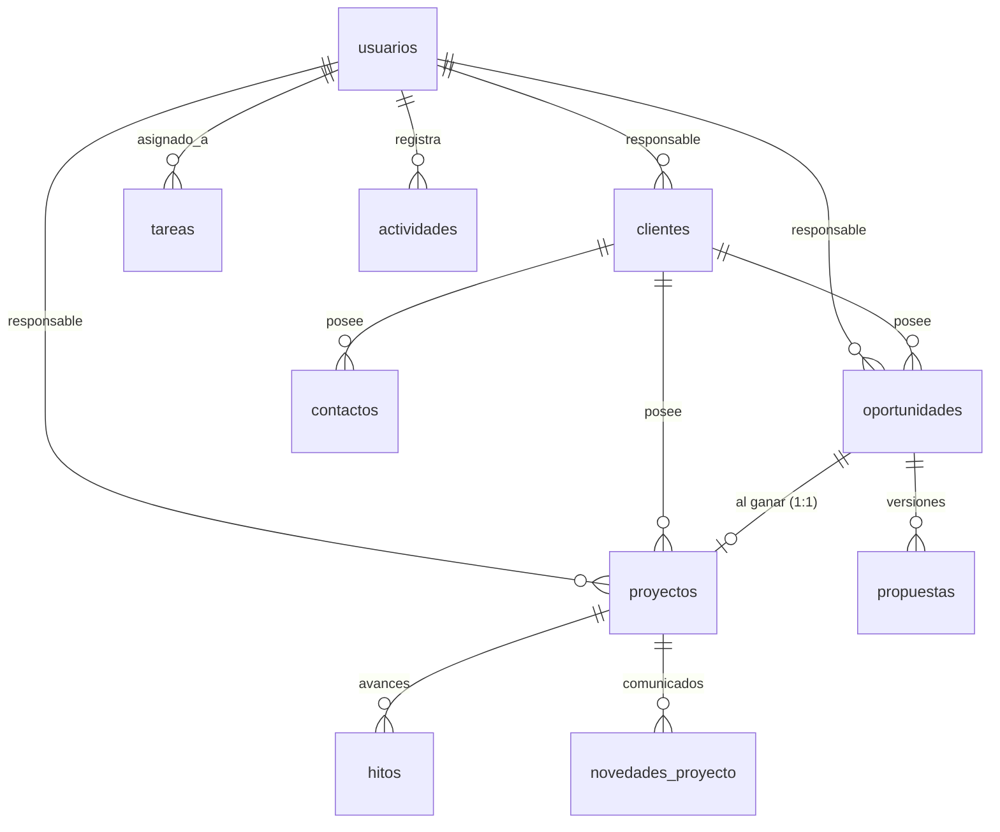

<div align="center">
  
</div>

<h1 align="center">🏛️ Arquitectura Backend - Sysmicon (Laravel 12 + CRM + API REST)</h1>

<h3 align="center">⚡ Migración Técnica de Alto Rendimiento: De PHP Puro a Laravel 12 Empresarial</h3>

<p align="center">
  Documentación exhaustiva de arquitectura de software, módulo de autenticación con sesión de 12 horas y refresh token rotativo en cookie HttpOnly, doble guard de aislamiento (Staff vs Clientes), sistema CRM con pipeline Kanban, radicación PQR y reglas de autoprotección.
</p>

<div align="center">
  
  
  
  
  
  
  
  
  
</div>

---

## 📑 Tabla de Contenidos

1. [Visión General & Objetivos de la Migración](#-visión-general--objetivos-de-la-migración)
2. [Estructura del Proyecto (`backend-laravel/`)](#-estructura-del-proyecto-backend-laravel)
3. [Seguridad & Autenticación de Máximo Nivel](#-seguridad--autenticación-de-máximo-nivel)
   - [Ciclo de Sesión de 12 Horas](#ciclo-de-sesión-de-12-horas)
   - [Aislamiento Estricto: Staff vs Clientes](#aislamiento-estricto-staff-vs-clientes)
   - [Protección Contra Fuerza Bruta & 2FA TOTP](#protección-contra-fuerza-bruta--2fa-totp)
4. [Módulo CRM & Pipeline Comercial](#-módulo-crm--pipeline-comercial)
   - [Diagrama Entidad-Relación CRM](#diagrama-entidad-relación-crm)
   - [Reglas de Negocio Clave](#reglas-de-negocio-clave)
5. [Módulo Web, Portafolio & Sistema PQR](#-módulo-web-portafolio--sistema-pqr)
6. [Gateway de Correo Hostinger (`MailGateway`)](#-gateway-de-correo-hostinger-mailgateway)
7. [Script de Migración de Datos (`php puro` → `laravel`)](#-script-de-migración-de-datos)
8. [Guía de Pruebas Automatizadas](#-guía-de-pruebas-automatizadas)
9. [Directrices para Despliegue en Hostinger](#-directrices-para-despliegue-en-hostinger)

---

## 🎯 Visión General & Objetivos de la Migración

La migración desde el backend original en PHP puro hacia **`backend-laravel`** fue diseñada para dotar a **Sysmicon** de:
- **Estructura Empresarial en Capas**: Controladores ligeros, Actions desacopladas, Form Requests para validación rigurosa y Enums tipados en PHP 8.
- **Sesión de 12 Horas con Refresh Rotativo**: Máxima seguridad mediante access tokens de corta duración (15 min) y refresh tokens hasheados en base de datos almacenados en cookies seguras `HttpOnly` y `SameSite=Strict`.
- **CRM Integrado en el Dashboard**: Módulos de clientes, contactos empresariales, pipeline comercial Kanban con cálculo de probabilidades, propuestas, proyectos de obra, hitos de avance, tareas y registro de actividades.
- **Portal de Novedades para Clientes**: Registro público de clientes sin ninguna posibilidad de acceso al panel administrativo interno.
- **Paridad Total con el Frontend Existente**: Rutas compatibles y alias legacy (`/proyectos`, `/contacto`, `/cotizacion`, etc.) para garantizar transición suave tanto en Angular como en React.

---

## 📂 Estructura del Proyecto (`backend-laravel/`)

```
backend-laravel/
├── app/
│   ├── Actions/                        # Lógica de dominio encapsulada
│   │   └── ConvertirOportunidadEnProyecto.php
│   ├── Console/Commands/               # Comandos Artisan personalizados
│   │   └── MigrarBackendPhpPuroCommand.php
│   ├── Contracts/                      # Interfaces desacopladas
│   │   └── MailGateway.php
│   ├── Enums/                          # Enums backed tipados de PHP 8.1+
│   │   ├── EstadoMensaje.php           # nuevo, leido, en_gestion, convertido, archivado
│   │   ├── EstadoPqr.php               # radicado, en_tramite, respondido, cerrado
│   │   ├── EstadoPropuesta.php         # borrador, enviada, aceptada, rechazada
│   │   ├── EstadoProyecto.php          # activo, pausado, terminado
│   │   ├── EtapaOportunidad.php        # contacto, visita, propuesta, negociacion, ganado, perdido
│   │   ├── FaseProyecto.php            # diseno, licencias, obra, entregado
│   │   ├── GuardSesion.php             # staff, cliente
│   │   ├── OrigenCliente.php           # referido, web, redes, otro
│   │   ├── Rol.php                     # admin, arquitecto, comercial
│   │   ├── TipoActividad.php           # llamada, reunion, email, nota, visita
│   │   ├── TipoCliente.php             # persona, empresa
│   │   ├── TipoPqr.php                 # peticion, queja, reclamo, sugerencia
│   │   ├── TipoProyecto.php            # vivienda, remodelacion, comercial, otro
│   │   └── TipoServicio.php            # diseno_construccion_integral, etc.
│   ├── Http/
│   │   ├── Controllers/Api/V1/
│   │   │   ├── Admin/                  # Panel Administrativo y CRM
│   │   │   │   ├── Crm/                # Cliente, Oportunidad, Propuesta, Proyecto, Hito, Tarea, Actividad, DashboardCrm
│   │   │   │   ├── AdminAnalyticsController.php
│   │   │   │   ├── AdminConfigController.php
│   │   │   │   ├── AdminMensajeController.php
│   │   │   │   ├── AdminPortafolioController.php
│   │   │   │   ├── AdminPqrController.php
│   │   │   │   └── AdminUsuarioController.php
│   │   │   ├── Auth/                   # Login, Refresh, Me, Logout, 2FA TOTP (Staff)
│   │   │   ├── Cuenta/                 # Registro y Login de Clientes (Portal público)
│   │   │   └── Public/                 # Portafolio, Mensajes, PQR, Analytics, Config
│   │   ├── Middleware/
│   │   │   ├── AuthenticateJwt.php     # Valida Bearer JWT y verifica coincidencia de Guard
│   │   │   ├── EnsureRole.php          # Control de roles (admin, arquitecto, comercial)
│   │   │   ├── EnsureTwoFactor.php     # Obligatoriedad de 2FA para administradores
│   │   │   └── SecurityHeaders.php     # CSP, nosniff, DENY, HSTS, Referrer-Policy
│   │   └── Requests/                   # Validación estricta con Form Requests
│   ├── Models/                         # Eloquent Models con relaciones y casts tipados
│   │   ├── Usuario.php                 # Staff interno (tabla usuarios)
│   │   ├── CuentaCliente.php           # Clientes registrados (tabla cuentas_clientes)
│   │   ├── Cliente.php & Contacto.php  # Clientes y contactos de empresas
│   │   ├── Oportunidad.php & Propuesta.php
│   │   ├── Proyecto.php & Hito.php     # Obras de construcción del CRM
│   │   ├── Tarea.php & Actividad.php   # Seguimiento y bitácora
│   │   ├── Mensaje.php & Pqr.php       # Solicitudes web y PQRs
│   │   ├── PortafolioProyecto.php & PortafolioImagen.php
│   │   ├── PageView.php & SiteConfig.php
│   │   └── Sesion.php & AuditoriaAcceso.php
│   ├── Services/
│   │   ├── Auth/                       # TokenService, SesionService, BloqueoService, TwoFactorService, AuditoriaService
│   │   ├── CloudinaryService.php       # Gestión multimedia SDK v3
│   │   └── Mail/                       # LogMailGateway (listo para Hostinger API)
│   └── Support/
│       └── ApiResponse.php             # Estandarización JSON { success, data, message }
├── config/
│   ├── cors.php                        # Orígenes exactos con soporte de credenciales
│   └── sysmicon.php                    # Parámetros de TTL (15 min access, 12 h sesión, 30 min idle)
├── database/migrations/                # Esquemas y tablas normalizadas
├── routes/api.php                      # Enrutador central RESTful versión 1
└── tests/Feature/                      # Suite de 27 pruebas automáticas (132 aserciones)
```

---

## 🔒 Seguridad & Autenticación de Máximo Nivel

### Ciclo de Sesión de 12 Horas

```
[Cliente HTTP]                                       [Backend Laravel]
      │                                                     │
      ├─── 1. POST /api/v1/auth/login ─────────────────────►│
      │       (email + password + [otp])                    ├─► Verifica Argon2id
      │                                                     ├─► Crea Sesion (expira_at = now + 12h)
      │◄── 2. 200 OK + access_token (15 min) ───────────────┤
      │       Set-Cookie: sysmicon_refresh (HttpOnly)       │
      │                                                     │
      ├─── 3. Peticiones regulares con Authorization: Bearer─► (Valida JWT en memoria)
      │                                                     │
      ├─── 4. Al expirar los 15 min: POST /auth/refresh ───►│ (Envía Cookie)
      │                                                     ├─► Verifica que now < expira_at (12h)
      │                                                     ├─► Rota refresh token (invalida el anterior)
      │◄── 5. Nuevo access_token + Nueva Cookie ────────────┤
      │                                                     │
      └─── 6. A las 12 horas exactas: POST /auth/refresh ──►│
          ◄── 401 Unauthorized (Sesión concluida) ──────────┴─► Obliga a nuevo login
```

- **Rotación y Detección de Reutilización**: Cada vez que se usa el refresh token, este se anula y se genera uno nuevo. Si un atacante intenta reutilizar un token anterior, el sistema detecta la anomalía, asume compromiso de sesión y **revoca de inmediato a toda la familia de sesiones vinculadas**.
- **Inactividad de 30 minutos**: Si transcurren más de 30 minutos sin realizar refresco ni peticiones activas, la sesión se da por terminada por inactividad.

### Aislamiento Estricto: Staff vs Clientes

Para garantizar que **ningún cliente registrado pueda acceder al panel de administración**, la arquitectura separa por completo los modelos, tablas y guards:

| Criterio | Staff / Equipo Interno | Portal de Clientes |
| :--- | :--- | :--- |
| **Tabla BD** | `usuarios` | `cuentas_clientes` |
| **Modelo** | `App\Models\Usuario` | `App\Models\CuentaCliente` |
| **Columna Rol** | `rol` (`admin`, `arquitecto`, `comercial`) | **No existe** (sin roles de staff) |
| **Guard JWT** | `staff` | `cliente` |
| **Middleware de Ruta** | `jwt:staff` (+ `rol:admin`, `2fa`) | `jwt:cliente` |
| **Acceso a `/admin/*`** | Permitido según rol | **403 Forbidden estricto** |

### Protección Contra Fuerza Bruta & 2FA TOTP

1. **Bloqueo Progresivo**:
   - Tras 5 intentos fallidos consecutivos, la cuenta se bloquea automáticamente.
   - Nivel 1: Bloqueo de 15 minutos.
   - Nivel 2: Bloqueo de 1 hora.
   - Nivel 3: Bloqueo de 24 horas.
2. **Respuesta Constante**: En caso de credenciales inválidas, el tiempo de respuesta se mantiene constante mediante cómputo de hash ficticio para evitar ataques de enumeración basados en tiempo.
3. **2FA Obligatorio para Administradores**: Basado en TOTP RFC 6238 (`Google Authenticator`), con entrega de 8 códigos de recuperación de un solo uso.

---

## 💼 Módulo CRM & Pipeline Comercial

### Diagrama Entidad-Relación CRM



### Reglas de Negocio Clave

1. **Oportunidad Ganada → Proyecto de Obra (`Action ConvertirOportunidadEnProyecto`)**:
   - Al cambiar la etapa a `ganado`, una transacción atómica crea el `Proyecto` en fase inicial de `diseño`, asocia el presupuesto del valor estimado de la oportunidad y registra automáticamente un evento en la bitácora de `actividades`.
2. **Oportunidad Perdida**:
   - Exige obligatoriamente el campo `motivo_perdida` (validado a nivel de API con status 422 si falta). La probabilidad se ajusta automáticamente a 0%.
3. **Propuestas Comerciales**:
   - Consecutivo autoincremental por año (`PRO-2026-0001`, `PRO-2026-0002`, etc.).
4. **Regla de Autoprotección del Administrador Activo**:
   - En `AdminUsuarioController`, ningún administrador autenticado puede desactivarse ni eliminarse a sí mismo, evitando bloqueos accidentales permanentes del panel.

---

## 🌐 Módulo Web, Portafolio & Sistema PQR

### Diferenciación de Tablas: Portafolio Web vs Proyectos CRM
Para resolver la duplicidad de conceptos, la base de datos mantiene:
- **`portafolio_proyectos`**: Catálogo público de obras y diseños mostrados en la página web con sus imágenes en Cloudinary (`portafolio_imagenes`).
- **`proyectos`**: Obras reales de clientes gestionadas dentro del CRM con hitos, cronogramas y presupuestos.
- **Compatibilidad**: La ruta `GET /api/v1/proyectos` se mantiene como alias hacia el portafolio público para no romper el frontend.

### Sistema PQR (Peticiones, Quejas, Reclamos y Sugerencias)
- **Radicación Pública**: Genera un radicado único `PQR-YYYY-XXXXX`.
- **Plazo Legal**: Asigna automáticamente una `fecha_limite_respuesta` calculada a 15 días hábiles (21 días calendario).
- **Consulta Segura**: Los ciudadanos pueden consultar el estado y la respuesta ingresando su radicado y su correo electrónico registrado.

---

## 📧 Gateway de Correo Hostinger (`MailGateway`)

El sistema incluye una arquitectura desacoplada mediante la interfaz `App\Contracts\MailGateway`:
- **`LogMailGateway`**: Implementación activa para desarrollo y pruebas que registra las notificaciones en los logs locales (`storage/logs/laravel.log`).
- **Listo para Hostinger**: Cuando proporciones la API o credenciales SMTP de Hostinger, simplemente se crea `HostingerMailGateway` e inyecta en el contenedor de servicios de Laravel sin modificar los controladores.

Plantillas preparadas:
- Confirmación de cuenta registrada.
- Recuperación de contraseña.
- Acuse de radicación de PQR con radicado.
- Respuesta formal a PQR.
- Alerta al equipo comercial por nuevo mensaje en "Cotiza con nosotros".

---

## 🔄 Script de Migración de Datos

Para migrar la información de la base de datos del backend anterior en PHP puro, se creó el comando Artisan:

```bash
php artisan sysmicon:migrar-php-puro --host=127.0.0.1 --database=nombre_bd_antigua --username=usuario --password=clave
```

Este comando migra automáticamente:
1. Usuarios de staff desde `users` a `usuarios`.
2. Proyectos de portafolio desde `proyectos` a `portafolio_proyectos`.
3. Imágenes asociadas desde `proyecto_imagenes` a `portafolio_imagenes`.
4. Configuraciones generales desde `site_config`.

---

## 🧪 Guía de Pruebas Automatizadas

El backend cuenta con **27 pruebas automáticas de integración** con **132 aserciones** ejecutadas sobre base de datos en memoria SQLite:

```bash
cd backend-laravel
php artisan test
```

### Cobertura de Pruebas:
- **`AuthTest.php`** (15 tests): Emisión de JWT, cookie HttpOnly `Strict`, rotación de refresh, expiración absoluta de 12 horas, cierre por inactividad de 30 min, bloqueo progresivo por fuerza bruta, flujo completo de 2FA TOTP y cabeceras de seguridad.
- **`CrmTest.php`** (5 tests): Creación de clientes con contactos, conversión automática de oportunidad ganada a proyecto, requisito de motivo de pérdida, consecutivo de propuestas y endpoints de analíticas del dashboard.
- **`SitioWebTest.php`** (5 tests): Filtrado de catálogo público, validación del formulario "Cotiza con nosotros", ciclo de vida de PQR, conversión de mensaje web a Lead CRM y regla de autoprotección del administrador.
- **`PortalClienteTest.php`** (2 tests): Registro de clientes, verificación de sesión y **prueba de intrusión que comprueba que un token de cliente recibe 403 Forbidden al intentar acceder a cualquier ruta administrativa**.

---

## 🚀 Directrices para Despliegue en Hostinger

1. **Versión de PHP**: Configurar PHP 8.2 o superior en el panel hPanel de Hostinger.
2. **DocumentRoot**: Configurar el dominio o subdominio apuntando a la carpeta **`backend-laravel/public`**.
3. **Variables de Entorno (`.env`)**:
   - `APP_ENV=production` y `APP_DEBUG=false`.
   - `APP_KEY` generado con `php artisan key:generate`.
   - `JWT_SECRET` generado con cadena segura de 64 caracteres.
   - `AUTH_COOKIE_SECURE=true` (exige HTTPS).
   - Credenciales de base de datos MySQL de Hostinger (`DB_HOST`, `DB_DATABASE`, `DB_USERNAME`, `DB_PASSWORD`).
   - Credenciales de Cloudinary (`CLOUDINARY_CLOUD_NAME`, `CLOUDINARY_API_KEY`, `CLOUDINARY_API_SECRET`).
   - `CORS_ALLOWED_ORIGINS` con la URL de producción del frontend.
4. **Optimización de Producción**:
   ```bash
   php artisan config:cache
   php artisan route:cache
   php artisan view:cache
   php artisan migrate --force
   ```

---

## 👨‍💻 Desarrollador

<div align="center">
  <strong>Santiago Arbelaez Contreras</strong><br>
  Junior Full Stack Developer<br>
  Estudiante de Ingeniería de Sistemas – Universidad del Quindío
  <br><br>
  <a href="https://github.com/santiagoarbelaezc">
    
  </a>
  
  <a href="https://www.linkedin.com/in/santiago-arbelaez-contreras-9830b5290/">
    
  </a>
  
  <a href="https://portfolio-santiagoa.web.app/portfolio">
    
  </a>
</div>

<div align="center">
  
</div>
